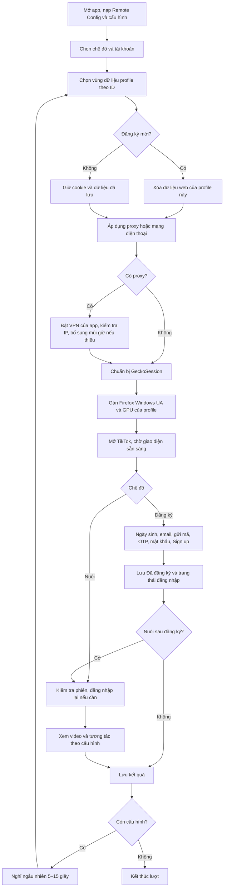

# Cơ chế hoạt động của Tool TikTok trên Android

Tài liệu mô tả **cách mã nguồn hiện tại chạy**, đối chiếu ngày 29/10/2026: trình duyệt, công cụ click/nhập liệu, delay, OTP, CAPTCHA, proxy, User-Agent và GPU. Thời gian dưới đây là giá trị trong code; thời gian thực tế còn cộng thêm tải trang, mạng và xử lý Android.

## 1. Thành phần nào làm việc gì?

| Thành phần | Vai trò thực tế |
| --- | --- |
| Flutter | Giao diện quản lý cấu hình, điều phối đăng ký/đăng nhập/nuôi, lưu kết quả |
| GeckoView | Trình duyệt nhúng trên Android, hiển thị website TikTok theo bố cục desktop |
| Android Accessibility Service — quyền Trợ năng | Đọc cây giao diện; chạm nút, vuốt, kéo thanh trượt, nhập dữ liệu qua hành động native |
| Profile tọa độ JSON | Vị trí đã đo cho đăng ký, đăng nhập và nuôi, kết hợp bounds của control đang hiển thị |
| MethodChannel | Cầu nối Dart với phần Android native để điều khiển GeckoView và Trợ năng |
| WebExtension tích hợp | Thực thi JavaScript, chuyển sự kiện về Flutter, thiết lập thuộc tính desktop và đọc thông tin trang cho một số tính năng |
| Android VpnService + hev-socks5-tunnel | Đưa lưu lượng ứng dụng qua proxy của cấu hình |
| OTP API | Đọc thư xác minh từ Data Mail, trả mã sáu chữ số |
| SadCaptcha | Trả góc giải CAPTCHA xoay; điều kiện thực sự kích hoạt ở mục 7 |
| Firebase Remote Config | Cung cấp URL/chứng chỉ OTP, khóa SadCaptcha, từ khóa tìm kiếm và bình luận |

**Nhập biểu mẫu đăng ký dùng Accessibility native**, không dùng Selenium/Playwright hoặc JavaScript gán giá trị vào ô nhập. JavaScript vẫn phục vụ cầu nối trình duyệt, nhận diện desktop, múi giờ và đọc CAPTCHA.

## 2. Luồng tổng thể từ khi bấm chạy



Lỗi chuẩn bị proxy chặn mở TikTok của cấu hình đó. Lỗi trong luồng tự động được trả về bộ điều phối để ghi nhận và xử lý cấu hình kế tiếp. Bấm Dừng hoặc đóng màn hình trước khi có kết quả có thể kết thúc lượt.

### Một cấu hình chứa gì?

- ID, tên cấu hình, email và mật khẩu TikTok.
- Data Mail: `email|mật khẩu hộp thư|refresh token|client ID|email phụ`.
- Proxy: giao thức, host, port, username, password; có thể để trống để dùng mạng thiết bị.
- User-Agent đã lưu, múi giờ và GPU desktop được gán cho cấu hình.
- Trạng thái đã đăng ký, dấu xác nhận phiên đăng nhập, lỗi đăng ký.
- Tùy chọn nuôi sau đăng ký, tỷ lệ tim/bình luận/xem lâu và khoảng thời gian nuôi.

Ngày sinh được sinh khi tạo lượt đăng ký: năm **1960–2004**, tháng/ngày hợp lệ ngẫu nhiên. Runner giữ cùng một ngày sinh trong một lần thử, không chọn lại ngày ở từng dropdown.

## 3. Click, cuộn và nhập liệu thực hiện bằng gì?

### 3.1. Đọc màn hình và chọn control

`SignupAccessibility.snapshot()` lấy cây Accessibility của GeckoView: nhãn, hint, loại ô nhập, trạng thái enabled/focused, độ dài nội dung và bounds của từng node.

Ví dụ để bấm **Send code**:

1. Đọc snapshot mới, kiểm tra vẫn đang ở `https://www.tiktok.com` và lượt chạy còn hiệu lực.
2. Tìm control nhãn `Send code`, đang bật và nằm trong khung trình duyệt.
3. Dùng tọa độ đã đo để chọn ứng viên phù hợp. Nếu modal desktop dịch chuyển, control khớp nhãn duy nhất vẫn có thể được chọn.
4. Điểm đã đo còn nằm trong bounds thì dùng điểm đó; nếu không, dùng tâm phần control đang nhìn thấy.
5. Quy đổi tọa độ thiết kế sang pixel màn hình rồi gửi gesture native.
6. Nghỉ theo loại thao tác, đọc lại giao diện để xác nhận bước kế tiếp.

Khung desktop có kích thước thiết kế **1920 × 955**. Công thức quy đổi điểm `(x, y)`:

```text
screenX = webBounds.left + x × webBounds.width / 1920
screenY = webBounds.top  + y × webBounds.height / 955
```

Không xác định được control hoặc điểm ngoài khung sẽ gây lỗi; runner không tiếp tục chạm tùy ý.

### 3.2. Gesture native

- Click: `FlutterAccessibilityService.dispatchGesture()` tại một điểm, thời lượng **140 ms**.
- Cuộn: gesture từ điểm đầu đến điểm cuối, thời lượng **450 ms**.
- Kéo CAPTCHA: `dispatchContinuousGesture()` để giữ và di chuyển liên tục, xem mục 7.

Đây là sự kiện chạm Android. Lớp nhận diện desktop còn chuyển thuộc tính pointer mà trang đọc được sang chuột.

### 3.3. Nhập email, mật khẩu và OTP

Tool chạm ô để lấy focus rồi gọi `signupPasteFocused(text, field)` xuống `SignupAccessibilityBridge.java`:

- Đưa nội dung vào clipboard và dùng `AccessibilityNodeInfo.ACTION_PASTE` với ô đang focus.
- Với một ô OTP dạng số phù hợp, bridge có nhánh dùng `ACTION_SET_TEXT`.
- Với OTP sáu ô hoặc một số trường hợp dán OTP không được nhận, bridge có nhánh nhấn giữ rồi chọn menu **Paste**.
- Đọc lại để xác nhận nội dung đã vào ô; mật khẩu kiểm tra bằng độ dài. OTP có thể được xác nhận qua đủ mã hoặc giao diện tự chuyển bước.
- Khôi phục clipboard sau khi xác nhận; trường hợp thất bại có cơ chế khôi phục trễ để tránh xóa nội dung khi Gecko chưa kịp đọc.

Ô email được phân biệt với tìm kiếm/ngày sinh; ô mật khẩu phải có thuộc tính password. OTP hỗ trợ một ô hoặc sáu ô nằm cùng hàng.

Bàn phím Android được giữ ẩn trong luồng nhập liệu/chờ OTP để không che modal. Runner gia hạn mỗi **4 giây**, vì chính sách native có hiệu lực **10 giây**; kết thúc hoặc hủy sẽ trả lại chính sách bàn phím.

### 3.4. Điều kiện thao tác

Phải bật Trợ năng, có khung trình duyệt hợp lệ và lượt chạy còn hiệu lực. Khi thanh thông báo/hộp thoại hệ thống che app, runner đăng ký chờ và kiểm tra lại mỗi **250 ms**. Đưa app hẳn xuống nền có thể hủy đăng ký. Rời đúng host TikTok sẽ dừng thao tác.

## 4. Luồng đăng ký chi tiết

Điều phối tại `TikTokController._runCoordinateSignup()`, chạy từng bước tại `SignupCoordinateRunner`.

| Bước | Tool thực hiện | Điều kiện để đi tiếp |
| --- | --- | --- |
| 1. Kiểm tra đầu vào | Kiểm tra email, mật khẩu, thông tin OTP, Trợ năng; nạp `signup-coordinate-profile.json` | Đủ dữ liệu, profile tọa độ hoàn chỉnh, trang còn hoạt động |
| 2. Chờ trang đầu | Đọc Accessibility; đóng cookie **Allow all** hoặc gợi ý **Got it** khi nhận diện được | Trang và nút vào đăng ký ổn định theo mục 5 |
| 3. Mở đăng ký | Nếu cần: **Log in → Sign up**; đã ở hộp đăng ký thì đi tiếp | Thấy `Sign up for TikTok` |
| 4. Chọn phương thức | **Use phone or email → Use email** | Thấy ô email |
| 5. Ngày sinh | Chọn **Year → Month → Day**, ưu tiên vị trí đã hiệu chuẩn | Đọc lại đủ ba giá trị khớp ngày đã chọn |
| 6. Nhập email | Ẩn bàn phím, focus và dán email cấu hình | Dán thành công, thấy `Send code` hợp lệ |
| 7. Gửi mã | Bấm **Send code** | Thấy nội dung resend/verify email/enter code trong 20 giây |
| 8. Lấy OTP | Dùng OTP có sẵn trong cấu hình chạy nếu có; còn lại gọi API | Nhận đúng sáu chữ số; timeout được phép resend một lần |
| 9. Nhập OTP | Focus và dán mã | Thấy ô mật khẩu hoặc nút `Next/Continue/Verify/Confirm` trong 15 giây |
| 10. Xác nhận OTP | Nếu trang chưa tự chuyển, bấm nút xác nhận | Thấy ô mật khẩu trong 15 giây |
| 11. Mật khẩu | Focus và dán mật khẩu TikTok | Độ dài ô khớp mật khẩu cấu hình, nút `Sign up` xuất hiện |
| 12. Tạo tài khoản | Bấm **Sign up** | Trong 30 giây thấy màn tạo username hoặc giao diện đã đăng nhập |
| 13. Username | Nếu có màn tạo username thì chờ và bấm **Skip** | Xác nhận trạng thái sau Skip trong tối đa 40 giây |
| 14. Lưu kết quả | Đánh dấu đã đăng ký, lưu trạng thái phiên | Kết thúc hoặc chuyển sang đăng nhập/nuôi theo tùy chọn |

**Ngày sinh có kiểm tra lại.** Bấm theo tọa độ không khớp thì đọc các mục dropdown qua Accessibility rồi cuộn đến giá trị cần chọn. Nhánh phục hồi giới hạn 80 vòng, không cho lặp quá ba lượt cuộn trên cùng một dải giá trị. Ngày sinh không khớp thì dừng trước khi gửi mã.

**Không bấm lặp vô hạn.** Action đăng ký được ghi nhận để tránh gửi lặp. Riêng mở **Log in** được thử tối đa ba lần, mỗi lần chờ phản hồi 10 giây. Trang đầu không sẵn sàng được tải lại tối đa một lần, ở giai đoạn chưa nhập/gửi biểu mẫu.

### Khi nào được tính là đã đăng ký?

- Giao diện đã đăng nhập được nhận diện qua **Messages + Profile**, đồng thời không còn nút/modal đăng nhập, đăng ký, ô mật khẩu hoặc màn tạo username.
- Callback sau khi chạm **Skip** đã có thể đánh dấu cấu hình đã đăng ký; runner tiếp tục kiểm tra trạng thái phiên.
- Nếu sau Skip xuất hiện `Log in to TikTok`, hoặc về trang chưa đăng nhập ổn định ít nhất **8 giây**, tài khoản vẫn được ghi đã tạo nhưng phiên cần đăng nhập lại.
- Bật **nuôi sau đăng ký** thì app đăng nhập trước khi nuôi nếu phiên chưa đăng nhập.

**Đã đăng ký** và **Đang đăng nhập** là hai trạng thái riêng; kết quả dựa trên giao diện và dấu lưu của ứng dụng.

## 5. Delay và timeout của đăng ký

Tool kết hợp **nghỉ sau thao tác** với **đợi điều kiện giao diện**. Hết delay chưa có nghĩa được chuyển bước; trạng thái kế tiếp vẫn phải được xác nhận.

### 5.1. Khoảng nghỉ sau thao tác

| Tình huống | Giá trị trong code |
| --- | --- |
| Click thường: mở modal, Use email, Send code, Sign up, Skip… | Ngẫu nhiên **2.000–7.000 ms** sau mỗi action |
| Focus ô nhập trong đăng ký | Cũng **2.000–7.000 ms**, kể cả focus OTP |
| Dán email/mật khẩu | Thêm **2.000–7.000 ms** sau khi bridge hoàn tất |
| Dán OTP | **650 ms** sau khi bridge hoàn tất; không áp dụng cho cú focus trước đó |
| Mở dropdown/chọn/cuộn ngày sinh | Ngẫu nhiên **1.000–3.000 ms** sau từng thao tác |
| Đóng cookie/thông báo bằng gesture | **2.000–7.000 ms** |
| Đọc giao diện trong `_wait()` | **300 ms** giữa các lần kiểm tra chưa đạt |
| Chờ khung web tạm mất khi điều hướng | Đọc mỗi **250 ms**, tối đa **8 giây** |
| Controller chờ kết quả OTP đang chạy | **250 ms**; chỉ đọc trạng thái nội bộ, không gọi API mỗi 250 ms |
| Giữa hai cấu hình tự chạy | Ngẫu nhiên **5–15 giây** |

Ví dụ **nhập email**: click ô khoảng 140 ms → nghỉ 2–7 giây → xác nhận focus → bridge dán và kiểm tra → nghỉ thêm 2–7 giây → đọc trạng thái nút gửi mã. Cả bước này có nhiều khoảng nghỉ, không chỉ một lần 2–7 giây.

### 5.2. Mốc chờ quan trọng

| Điều kiện | Giới hạn |
| --- | --- |
| Trang đầu có nút đăng nhập/đăng ký dùng được | Tối đa **60 giây** mỗi lần chờ |
| Trang đã báo tải xong | Tải ổn định **5 giây**, bounds nút ổn định **2 giây** |
| Chưa báo tải xong nhưng nút đã dùng được | Sau ít nhất **20 giây**, chấp nhận nút ổn định **3 giây** |
| Focus ô email/OTP/mật khẩu | **5 giây** |
| `_wait()` không truyền giới hạn riêng | **30 giây** |
| TikTok xác nhận gửi mã lần đầu | **20 giây** |
| Xác nhận OTP/chờ ô mật khẩu | **15 giây** cho từng lần đợi tương ứng |
| Kết quả sau Sign up | **30 giây** |
| Hoàn tất sau Skip | **40 giây** |
| Toàn luồng tự động của một cấu hình | Giá trị lớn hơn giữa **15 phút** và **thời gian nuôi tối đa + 12 phút** |
| Khi luồng tự động được xác định thất bại | Thường giữ lỗi **15 giây** trước khi trả kết quả thất bại |

Đây là giới hạn tại từng vòng chờ/tác vụ; mạng, CAPTCHA và bridge có thời gian xử lý riêng. Delay thao tác hiện nằm trong code, không phải thông số người dùng chỉnh trên màn hình cài đặt.

## 6. OTP: gọi dịch vụ, chờ và gửi lại

URL lấy từ `otp_api_url` trong Remote Config. Chứng chỉ tự ký được tin cậy theo host và PEM cấu hình tại `otp_api_certificate`. Tài liệu không chép khóa dịch vụ hay dữ liệu hộp thư thật.

### 6.1. Nhánh Data Mail

```text
TikTok gửi email xác minh
    → Tool gọi GET /api/extract-otp?rawInput=<Data Mail 5 phần>
    → Dịch vụ đọc hộp thư và trả OTP
    → Tool kiểm tra 6 chữ số rồi dán bằng Accessibility
```

- Data Mail phải đủ năm phần, không có phần trống hoặc xuống dòng.
- Chưa có mã thì nghỉ **5 giây** rồi hỏi API lại; chu kỳ còn cộng thời gian request trước đó.
- Chờ mặc định **180 giây**; timeout bao toàn tác vụ là **180 + 15 = 195 giây**.
- API có thể trả timeout sớm, chẳng hạn HTTP 408/504 ở nhánh Data Mail.
- Parser nhận mã chuỗi sáu chữ số, kể cả trong `otp`, `code` hoặc `data` theo cấu trúc được hỗ trợ.
- Không theo redirect khi gửi thông tin hộp thư.

Code còn hỗ trợ API kiểu POST với `email: "email|password"`, `wait: 180` khi URL/dữ liệu phù hợp nhánh đó. Cấu hình Data Mail đầy đủ đi theo nhánh GET trên.

### 6.2. Hết thời gian chờ

1. Nếu lỗi là **timeout OTP**, chờ **Resend code** được bật, tối đa **75 giây**.
2. Bấm Resend đúng **một lần**; đợi countdown hoặc nút resend bị tắt, tối đa **15 giây**.
3. Hủy request cũ, tạo lượt lấy OTP mới.
4. Lượt mới vẫn timeout thì dừng, không gửi lại thêm.

Lỗi kết nối, dữ liệu sai hoặc API khác lỗi timeout không tự đi qua nhánh resend này.

**Khác biệt đăng ký/đăng nhập:** đăng nhập truyền mốc thời gian yêu cầu và danh sách mã đã bị từ chối, giúp bỏ mã sai và thư cũ nếu API có `receivedAt`. Đăng ký hiện truyền `notBefore: null`, nên không bảo đảm lọc thư cũ theo thời gian trong nhánh này.

## 7. CAPTCHA: khả năng có sẵn và điều kiện thực sự chạy

### 7.1. Giới hạn kích hoạt hiện tại

**Bộ giải tự động yêu cầu `autoWatchEnabled == true`.** `_canCheckRotateCaptcha` còn yêu cầu app/trang TikTok đang hiển thị, bridge hoạt động, không lỗi trang, đã nạp cài đặt và có khóa SadCaptcha.

Khi bắt đầu đăng ký/đăng nhập, controller đặt `autoWatchEnabled = false`. Dù runner có hook `_checkRotateCaptcha` trước snapshot/thao tác, **không nên hiểu rằng CAPTCHA tự được giải trong lúc đăng ký hoặc đăng nhập hiện tại**. CAPTCHA ở các bước này có thể khiến luồng chờ rồi timeout nếu chưa được xử lý trên màn hình.

Khi tự xem/nuôi bật và đủ điều kiện, monitor kiểm tra khoảng **1 giây/lần**, tránh kiểm tra lúc Accessibility đang có action. Bộ giải chuyên cho **CAPTCHA xoay**, không phải mọi kiểu xác minh.

### 7.2. Khi bộ giải được kích hoạt

1. JavaScript đọc hai ảnh vòng ngoài/vòng trong, kích thước viewport, vị trí tay nắm và quãng kéo qua bridge GeckoView.
2. Chờ CAPTCHA tải nếu cần, tối đa **15 giây**, đọc lại mỗi **300 ms**.
3. Lấy ảnh từ data URL hoặc tải HTTPS; giới hạn **5 MiB/ảnh**, timeout tải **15 giây** cho các pha mạng được đặt trong code.
4. Gửi ảnh base64 tới `POST https://www.sadcaptcha.com/api/v1/rotate`, dùng khóa `sadcaptcha_license_key`; timeout gửi/đọc phản hồi tương ứng **30 giây**.
5. Nhận góc `angle` trong 0–360; nghỉ ngẫu nhiên **800–2.000 ms**.
6. Đọc lại ảnh/bounds để chắc CAPTCHA và khung chưa đổi, quy đổi góc thành điểm kéo trên màn hình.
7. Kéo bằng Accessibility liên tục: giữ đầu **80–180 ms**, di chuyển nhiều đoạn khoảng **700–1.200 ms**, có đoạn chỉnh điểm cuối, giữ cuối **150–350 ms** rồi thả. Tổng thời gian cộng các đoạn này.
8. Kiểm tra mỗi **400 ms**, tối đa **12 giây**; xác nhận giải xong khi CAPTCHA vắng mặt **hai lần liên tiếp**.

Mỗi lượt giải tối đa **ba lần thử**. Kéo chưa thành công thì chờ đề tự đổi 3 giây; cần thiết thì bấm Refresh và chờ tối đa 8 giây. Các StateError có thể retry nghỉ 1 giây, nhưng lỗi API không retry được như 401/402/403 dừng sớm. Một số ngoại lệ mạng khác cũng có thể kết thúc trước ba lần.

Controller nhớ lỗi của cùng cặp ảnh và khóa để không gọi lại vô hạn. Luồng nuôi có cơ chế tạm dừng để xác minh; giới hạn thời gian chung của lượt tự động vẫn còn hiệu lực.

## 8. Proxy: đường đi, kiểm tra và đổi cấu hình

### 8.1. Đường đi mạng

```text
GeckoView / request mạng của ứng dụng
    → Android VPN riêng cho ứng dụng
    → hev-socks5-tunnel
    → Máy chủ proxy được khai báo
    → TikTok / OTP API / dịch vụ tra IP, múi giờ / SadCaptcha
```

VPN chỉ route lưu lượng ứng dụng, không đổi proxy toàn bộ điện thoại. Máy chủ proxy được loại khỏi route VPN để tránh vòng lặp. Không có proxy thì app dùng mạng hiện tại.

| Giao thức | Cách triển khai |
| --- | --- |
| SOCKS5 | Tunnel nối trực tiếp tới SOCKS5 theo cấu hình |
| HTTP | Tunnel → SOCKS5 cục bộ → HTTP CONNECT; hỗ trợ Basic username/password |
| HTTPS | Như HTTP CONNECT, thêm TLS và xác minh chứng chỉ kết nối tới proxy |

HTTP là mặc định khi không ghi giao thức. SOCKS5 cục bộ cho HTTP/HTTPS có xác thực ngẫu nhiên theo tunnel. CONNECT chuyển tiếp TCP và cần nhà cung cấp cho phép cổng đích; không đồng nghĩa hỗ trợ mọi giao thức mạng.

### 8.2. Trước khi mở TikTok

1. Đọc proxy đúng cấu hình; lần đầu có thể cần cấp quyền VPN Android.
2. Thiết lập VPN trước GeckoSession; đóng tunnel/kết nối cũ khi đổi cấu hình.
3. Gọi `api.ipify.org`, thất bại thì thử `api64.ipify.org`; **8 giây/request**.
4. Không lấy được IP hợp lệ thì báo proxy không kết nối được, chặn mở luồng.
5. Có proxy nhưng thiếu múi giờ: tra `ipwho.is`, timeout **12 giây**, lưu múi giờ vào cấu hình.
6. Xác nhận VPN còn chạy cho đúng ID rồi mới mở TikTok.

Kiểm tra IP xác nhận request qua kết nối hiện tại trả IP hợp lệ; không đối chiếu với một IP đầu ra cố định do người dùng khai báo.

### 8.3. Trùng proxy và xoay IP

Đăng ký bị chặn nếu cấu hình tài khoản khác có cùng **URI proxy và username**. Mật khẩu khác không làm thành proxy riêng. Đây là kiểm tra cấu hình khai báo, không phát hiện hai endpoint khác nhau dùng chung IP đầu ra.

Luồng đăng ký không có bước gọi API xoay IP. IP thay đổi theo nhà cung cấp là hành vi của dịch vụ proxy. Múi giờ đã cache không được tự tra lại mỗi bước khi IP phía nhà cung cấp đổi.

## 9. User-Agent, GPU, màn hình và múi giờ

### 9.1. User-Agent

Cấu hình Android được chuẩn hóa về Firefox Windows, kể cả UA cũ là Chrome/Edge/giá trị nhập tay:

```text
Mozilla/5.0 (Windows NT 10.0; Win64; x64; rv:158.0) Gecko/20100101 Firefox/158.0
```

Native gán `userAgentOverride` cho GeckoSession và preference runtime. Request kiểm tra IP/múi giờ và tải ảnh CAPTCHA cũng dùng UA Firefox này. UA không được bốc ngẫu nhiên ở mỗi bước.

### 9.2. GPU theo cấu hình

**Mã hiện tại hỗ trợ bốn GPU desktop, không cố định tất cả tài khoản vào AMD.** Khi tạo cấu hình, store chọn ngẫu nhiên một `DesktopGpu`, lưu `desktop_gpu`; cấu hình cũ thiếu trường này dùng AMD mặc định.

| ID lưu | GPU được công bố |
| --- | --- |
| `amd-r9-200` | AMD Radeon R9 200 Series |
| `intel-hd-400` | Intel HD Graphics 400 |
| `intel-hd` | Intel HD Graphics |
| `nvidia-gtx-980` | NVIDIA GeForce GTX 980 |

Đường truyền: `ProxyStore → AppConfiguration.desktopGpu → GeckoBrowserView → GeckoPlatformView → FirefoxDesktopIdentity.apply(gpu)`.

Native đặt vendor/renderer WebGL; extension điều chỉnh tham số, extension và giới hạn theo nhóm GPU. Ví dụ AMD công bố vendor `Google Inc. (AMD)`, renderer `ANGLE (AMD, Radeon R9 200 Series Direct3D11 vs_5_0 ps_5_0), or similar`.

GPU giữ theo bản ghi, không bốc lại sau mỗi lần mở trang. Preference native ở cấp runtime, áp dụng cho trình duyệt đang mở; tool chạy tuần tự từng cấu hình. Giá trị công bố không biến GPU thật của điện thoại thành GPU PC.

### 9.3. Thuộc tính desktop khác

| Thuộc tính | Giá trị/cách áp dụng |
| --- | --- |
| Nền tảng | `Win32`, Windows 10 x64 |
| Ngôn ngữ | `en-US, en`; runner đăng ký cần nhãn tiếng Anh |
| Screen | 1920 × 1080, 24 bit; vùng khả dụng 1920 × 1040 |
| Cửa sổ | 1936 × 1056, vị trí −8, −8 |
| Trang | Khung thiết kế 1920 × 955; native tính scale theo bề rộng view thực |
| DPR được công bố | 1 |
| Touch | `maxTouchPoints = 0`; pointer từ chạm được công bố là mouse |
| CPU | `hardwareConcurrency` hiện giữ native, không cố định 16 |
| WebRTC | Bật API, đặt preference hạn chế ICE/host candidate và yêu cầu proxy |
| WebGPU | Bật API, cho backend native thử tạo adapter; khả năng thực tế tùy thiết bị |
| Múi giờ | Theo profile khi có proxy; mặc định desktop `Asia/Bangkok` khi không dùng proxy |

Lớp thuộc tính desktop chạy tại `document_start` trong các frame. Riêng script múi giờ đi qua cầu nối bất đồng bộ, có thể chạy sau script đầu của trang hoặc chịu CSP; chỉ áp dụng document/frame, không đổi múi giờ Android/worker.

Engine và phần cứng vẫn là Android. Font, canvas, codec, kết quả render, CPU và GPU thật không trở thành Windows vì sửa giá trị công bố. IP/ISP/vị trí phụ thuộc kết nối mạng thực tế.

## 10. Cookie và phiên đăng nhập

Mỗi cấu hình có `GeckoSessionSettings.contextId = profile-<ID>`. Gecko phân vùng cookie và DOM storage theo context, giữ dữ liệu cho lần mở sau.

- **Đăng ký mới:** `AccountSessions.activate(fresh: true)` gọi `clearContext` cho đúng profile, xóa dấu đăng nhập của profile đó.
- **Nuôi/đăng nhập lại:** giữ vùng dữ liệu, mở lại context tương ứng.
- **Chuyển cấu hình:** đổi context, proxy và GPU theo bản ghi được chọn.
- **Lưu phiên:** SharedPreferences giữ dấu xác nhận đăng nhập theo ID; cookie và storage do Gecko quản lý.

Dấu cục bộ không bảo đảm cookie còn hiệu lực. Trước khi nuôi, app xác nhận giao diện đã đăng nhập; nếu chưa thì chạy đăng nhập bằng tài khoản cấu hình.

## 11. Đăng nhập và nuôi sau đăng ký

### 11.1. Đăng nhập

`LoginAccessibilityRunner` dùng cùng gesture/paste native với profile tọa độ riêng. Nó nhận diện trạng thái hiện tại, mở **Log in → Use phone/email → email/username** khi cần, nhập email/mật khẩu, xử lý xác minh email và OTP nếu được yêu cầu.

Click thường nghỉ **2–7 giây**; nhánh `fast` như gửi/xác nhận mã hoặc submit dùng **250 ms**. Delay đăng ký mục 5 không áp dụng nguyên xi cho đăng nhập. OTP bị từ chối được nhận diện riêng, có thể xóa đúng mã vừa nhập và gửi lại có giới hạn.

Chỉ xác nhận đăng nhập mới chuyển sang nuôi. Màn xác minh danh tính không được hỗ trợ có thể khiến luồng dừng để xử lý trên màn hình.

### 11.2. Nuôi tài khoản

Mỗi phiên chọn giữa bảng tin và tìm kiếm từ khóa; thiếu từ khóa thì dùng bảng tin. Runner đọc video/control qua Accessibility, dùng tọa độ đã đo kết hợp bounds để thao tác.

| Thông số | Mặc định |
| --- | --- |
| Xác suất lên kế hoạch tim | 30% |
| Xác suất lên kế hoạch bình luận | 20% |
| Xác suất xem lâu nếu không được chọn tim/bình luận | 50% |
| Thời lượng phiên | Ngẫu nhiên 2–3 phút, hoặc khoảng min/max đã lưu |

Video chọn tim/bình luận được xem hết trong giới hạn; video dài quá một phút bị giới hạn xem **60 giây**. Nhánh bỏ qua sớm chọn **2–5 giây**, nhưng không vượt quá nửa thời lượng video và có xử lý riêng video ngắn. Thời điểm tương tác được chọn phù hợp thời lượng và thời gian còn lại.

Các tỷ lệ là xác suất; số hành động còn phụ thuộc nội dung, control, lỗi và thời gian phiên. Lỗi tạm thời có thể được đọc lại/phục hồi trên trang hiện tại. Thời gian xem, video, tim, bình luận và kết quả được lưu trong lịch sử nuôi.

## 12. Chạy lần lượt và xử lý lỗi

| Chế độ | Cấu hình được chọn |
| --- | --- |
| Đăng ký | Có tài khoản, chưa đăng ký, chưa nằm trong danh sách đăng ký lỗi |
| Nuôi | Có tài khoản, đã đăng ký |
| Đăng ký lại | Chưa đăng ký, đang được đánh dấu đăng ký lỗi |

Mỗi ID xử lý tối đa một lần trong lượt. **Chạy trước** được ưu tiên nếu hợp lệ; mặc định phần còn lại theo danh sách mới nhất trước. Giữa hai cấu hình nghỉ ngẫu nhiên 5–15 giây, chờ app trở lại foreground nếu cần.

| Tình huống | Xử lý hiện có |
| --- | --- |
| Proxy lỗi/tra múi giờ thất bại | Chặn mở TikTok, báo lỗi chuẩn bị |
| Trang đầu thiếu nút dùng được | Chờ rồi reload tối đa một lần trước nhập liệu |
| Ngày sinh sai/thiếu control | Dừng, không gửi tiếp biểu mẫu |
| OTP API timeout | Resend tối đa một lần theo mục 6 |
| OTP sai/hết hạn trong đăng ký | Dừng, giữ màn hiện tại; không coi như API timeout để tự resend |
| Email đã đăng ký | Báo đổi trạng thái tài khoản để dùng đăng nhập/nuôi |
| TikTok báo quá nhiều lần thử/yêu cầu | Dừng thao tác |
| CAPTCHA trong đăng ký/đăng nhập | Bộ giải bị điều kiện `autoWatchEnabled` chặn; có thể timeout nếu chưa xử lý |
| Luồng tự động thất bại | Ghi lỗi đăng ký nếu phù hợp; thường giữ lỗi 15 giây rồi trả kết quả |
| Hết watchdog | Kết thúc luồng theo giới hạn, báo chưa hoàn tất |
| Đóng màn hình trước kết quả/bấm Dừng | Dừng lượt |

Lỗi đăng ký lưu kèm bước/lý do để xem ở **Cấu hình lỗi** và chạy lại. Cấu hình/lịch sử/thống kê có thể nhập/xuất theo định dạng app hỗ trợ; Excel không mang cookie/storage Gecko.

## 13. Mã nguồn để kiểm tra hoặc thay đổi cơ chế

Đường dẫn tương đối từ tài liệu này:

| Cơ chế | File chính |
| --- | --- |
| Điều phối, proxy preflight, nghỉ giữa cấu hình | [home_controller.dart](../lib/core/controller/home_controller.dart) |
| Đăng ký/đăng nhập/nuôi, watchdog, điều kiện CAPTCHA | [tiktok_controller.dart](../lib/core/controller/tiktok_controller.dart) |
| Các bước và delay đăng ký | [signup_coordinate_runner.dart](../lib/core/signup_coordinate_runner.dart) |
| Snapshot, tọa độ, gesture, thời lượng chạm/vuốt/kéo | [signup_accessibility.dart](../lib/core/signup_accessibility.dart) |
| Clipboard, ACTION_PASTE/SET_TEXT, Paste menu | [SignupAccessibilityBridge.java](../third_party/flutter_accessibility_service/android/src/main/java/slayer/accessibility/service/flutter_accessibility_service/SignupAccessibilityBridge.java) |
| Tọa độ đăng ký | [signup-coordinate-profile.json](../assets/signup-coordinate-profile.json) |
| OTP API, polling, timeout | [otp_api.dart](../lib/core/otp_api.dart) |
| CAPTCHA xoay | [rotate_captcha.dart](../lib/core/rotate_captcha.dart), [rotate_captcha_script.dart](../lib/core/scripts/rotate_captcha_script.dart) |
| VPN/tunnel | [webview_proxy.dart](../lib/core/webview_proxy.dart), [ProfileVpnService.kt](../android/app/src/main/kotlin/com/brisklane/browser/proxy/ProfileVpnService.kt) |
| Trùng proxy | [account_proxy.dart](../lib/core/account_proxy.dart) |
| IP/múi giờ | [webview_proxy_ip.dart](../lib/core/webview_proxy_ip.dart), [proxy_geolocation.dart](../lib/core/proxy_geolocation.dart) |
| UA/GPU | [firefox_user_agent.dart](../lib/core/firefox_user_agent.dart), [desktop_gpu.dart](../lib/core/desktop_gpu.dart), [proxy_store.dart](../lib/core/proxy_store.dart) |
| Nhận diện native/extension | [GeckoPlatformView.kt](../android/app/src/main/kotlin/com/brisklane/browser/gecko/GeckoPlatformView.kt), [FirefoxDesktopIdentity.kt](../android/app/src/main/kotlin/com/brisklane/browser/gecko/FirefoxDesktopIdentity.kt), [desktop_identity.js](../android/app/src/main/assets/gecko_bridge/desktop_identity.js) |
| Script múi giờ | [webview_timezone.dart](../lib/core/webview_timezone.dart) |
| Phân vùng phiên | [account_sessions.dart](../lib/core/account_sessions.dart) |
| Đăng nhập/nuôi | [login_accessibility_runner.dart](../lib/core/login_accessibility_runner.dart), [nurture_accessibility_runner.dart](../lib/core/nurture_accessibility_runner.dart) |
| Dịch vụ trung tâm | [remote_config_service.dart](../lib/core/services/remote_config_service.dart), [hướng dẫn Firebase](huong-dan-cau-hinh-firebase.md) |
