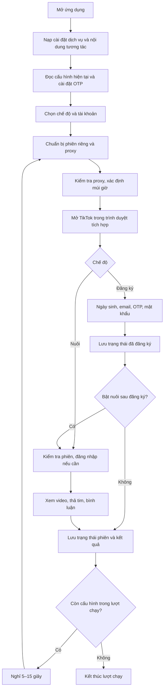

# Cơ chế hoạt động của Tool TikTok

Tool chạy trên Android, quản lý cấu hình tài khoản TikTok và tự thao tác trên website TikTok bằng trình duyệt tích hợp. Các nghiệp vụ chính gồm đăng ký tài khoản, đăng nhập, nuôi tài khoản, quản lý proxy và lưu kết quả hoạt động.

## 1. Các nhóm chức năng

| Chức năng | Cách hoạt động |
| --- | --- |
| Quản lý cấu hình | Lưu thông tin tài khoản, hộp thư, proxy, nhận diện trình duyệt và thông số nuôi |
| Đăng ký | Điền biểu mẫu, lấy OTP email, hoàn tất tạo tài khoản và lưu trạng thái |
| Đăng nhập | Kiểm tra phiên đang có, đăng nhập lại và xử lý OTP khi cần |
| Nuôi tài khoản | Xem video, thả tim và bình luận theo tỷ lệ, thời gian đã đặt |
| Quản lý kết nối | Áp dụng proxy của cấu hình, kiểm tra kết nối và xác định múi giờ |
| Chạy lần lượt | Xử lý từng cấu hình, ghi kết quả, nghỉ rồi chuyển sang cấu hình tiếp theo |
| Quản lý dữ liệu | Theo dõi lịch sử, lỗi, thống kê và nhập/xuất Excel |

## 2. Luồng tổng thể



Nếu gặp lỗi khi chuẩn bị hoặc thực hiện, tool ghi nhận kết quả để xử lý cấu hình tiếp theo. Cấu hình đăng ký thất bại được đưa vào danh sách lỗi để kiểm tra và chạy lại.

## 3. Khởi động ứng dụng

Khi mở ứng dụng, tool nạp cấu hình đang chọn, thông tin dịch vụ lấy OTP, khóa xử lý CAPTCHA, danh sách từ khóa tìm kiếm và nội dung bình luận.

Các cài đặt dịch vụ, từ khóa và bình luận được lấy từ cấu hình trung tâm. Nếu tải mạng thất bại, tool dùng dữ liệu đã lưu hoặc giá trị mặc định có sẵn.

Sau khi nạp dữ liệu, tool mở màn hình chính và nhắc bật quyền Trợ năng để thực hiện thao tác tự động. Nếu không đọc được dữ liệu khởi động, người dùng có thể thử lại.

## 4. Một cấu hình gồm những gì?

Mỗi cấu hình có ID riêng, chứa proxy nếu sử dụng, email TikTok, mật khẩu TikTok, dữ liệu hộp thư để lấy OTP, User-Agent, múi giờ, GPU desktop, trạng thái đăng ký và thông số nuôi. Tùy chọn nuôi sau đăng ký quyết định tài khoản mới có tiếp tục xem video trong lượt hiện tại hay không.

Dữ liệu có thể được nhập từ file Excel/TXT hoặc clipboard. Với định dạng Data Mail đầy đủ, dữ liệu hộp thư gồm `email|mật khẩu|refresh token|client ID|email phụ`. Nếu bỏ trống mật khẩu TikTok trong định dạng import được hỗ trợ, app sinh mật khẩu trước khi lưu.

Hai trạng thái được quản lý riêng:

- **Đã đăng ký:** tài khoản đã đi qua luồng tạo tài khoản và được lưu vào danh sách đã đăng ký.
- **Đang đăng nhập:** trạng thái phiên hiện tại; dấu ghi cục bộ chỉ là gợi ý, app còn kiểm tra giao diện TikTok khi tái sử dụng phiên để nuôi.

## 5. Cách hoạt động của proxy

Proxy là máy chủ trung gian cho kết nối của tool. Khi dùng proxy, kết nối đến TikTok đi theo đường:

```text
Tool trên điện thoại → Kết nối VPN riêng của ứng dụng → Máy chủ proxy → TikTok
```

TikTok nhận kết nối qua IP đầu ra của proxy. Nếu không khai báo proxy, tool dùng mạng hiện tại của điện thoại.

Trước khi mở một tài khoản, tool thực hiện:

1. Đọc địa chỉ, cổng, giao thức và thông tin xác thực proxy của cấu hình.
2. Thiết lập kết nối qua proxy bằng cơ chế VPN trên Android, chỉ áp dụng cho lưu lượng của ứng dụng.
3. Gửi yêu cầu kiểm tra IP qua kết nối đó để xác nhận proxy hoạt động. Nếu không kết nối được, tool báo lỗi và không mở luồng TikTok của cấu hình.
4. Nếu chưa có múi giờ, tra theo vị trí IP proxy rồi lưu để dùng lại.
5. Xác nhận kết nối VPN của đúng cấu hình còn hoạt động trước khi mở TikTok.

Các giao thức được hỗ trợ:

| Loại proxy | Cách kết nối |
| --- | --- |
| HTTP | Tạo đường hầm tới máy chủ đích bằng CONNECT; hỗ trợ tên đăng nhập và mật khẩu |
| HTTPS | Tương tự HTTP nhưng kết nối tới máy chủ proxy được mã hóa TLS và kiểm tra chứng chỉ |
| SOCKS5 | Chuyển kết nối qua máy chủ SOCKS5 theo thông tin đã khai báo |

HTTP là lựa chọn mặc định khi dữ liệu nhập không ghi giao thức. HTTP/HTTPS được chuyển qua một cầu nối SOCKS5 cục bộ trước khi đi tới proxy; SOCKS5 sử dụng đường hầm trực tiếp. Máy chủ HTTP/HTTPS proxy phải cho phép CONNECT tới cổng đích.

Lần đầu bật proxy, Android yêu cầu cấp quyền VPN. Khi chuyển cấu hình, tool đóng đường hầm và các kết nối cũ rồi áp dụng proxy của cấu hình mới. Khi đăng ký, tool chặn proxy trùng địa chỉ, giao thức, cổng và tên đăng nhập với cấu hình tài khoản khác. Kiểm tra này dựa trên thông tin proxy đã khai báo; các địa chỉ proxy khác nhau vẫn có thể dùng chung IP đầu ra tùy nhà cung cấp.

## 6. Lưu và khôi phục phiên tài khoản

Mỗi ID cấu hình có vùng lưu cookie và dữ liệu website riêng. Vì vậy, các cấu hình có thể duy trì phiên đăng nhập tách biệt ngay trên cùng một điện thoại.

- **Đăng ký mới:** xóa dữ liệu phiên cũ của cấu hình đang chạy để bắt đầu lại.
- **Nuôi tài khoản:** mở lại vùng dữ liệu đã lưu, kiểm tra TikTok còn đăng nhập hay không và chỉ đăng nhập lại khi cần.
- **Chuyển cấu hình:** dùng vùng dữ liệu và proxy của cấu hình được chọn.
- **Kết thúc lượt chạy:** giữ dữ liệu phiên cho lần sử dụng sau và cập nhật dấu xác nhận đăng nhập.

Phiên được phân chia theo ID cấu hình. Cookie đã lưu có thể hết hạn hoặc bị TikTok thu hồi, nên tool phải kiểm tra trạng thái thực tế trên trang trước khi nuôi.

## 7. Cơ chế thao tác trên TikTok

Tool dùng quyền Trợ năng để đọc các thành phần đang hiển thị, xác định trang đang ở bước nào và tìm nút hoặc ô nhập theo nhãn. Vị trí thao tác được kết hợp với bộ tọa độ đã đo, điều chỉnh theo khung trình duyệt thực tế trên màn hình.

Sau mỗi thao tác, tool chờ giao diện chuyển sang trạng thái tương ứng trước khi làm bước tiếp theo. Các ô email, OTP và mật khẩu được nhận diện riêng. Trong lúc nhập liệu, bàn phím được giữ ẩn để hạn chế thay đổi bố cục, rồi được trả lại trạng thái bình thường khi kết thúc hoặc hủy.

Thao tác chỉ tiếp tục khi lượt chạy còn hiệu lực và đang ở đúng trang TikTok. Hoạt động tự động cần quyền Trợ năng và ứng dụng đang hiển thị trên màn hình.

## 8. Luồng đăng ký

Quá trình đăng ký diễn ra theo trình tự:

1. Chờ trang sẵn sàng, xử lý các thông báo cookie hoặc hướng dẫn được nhận diện.
2. Mở **Sign up → Use phone or email → Use email**.
3. Chọn ngày sinh do app sinh ngẫu nhiên, nhập email và bấm **Send code**.
4. Chờ TikTok xác nhận gửi mã, gọi dịch vụ OTP và nhập mã sáu chữ số.
5. Bấm nút xác nhận OTP nếu trang yêu cầu, rồi nhập mật khẩu TikTok.
6. Bấm **Sign up**, xử lý bước tạo username bằng **Skip** khi xuất hiện và xác nhận kết quả.
7. Lưu trạng thái đã đăng ký, sau đó kết thúc hoặc chuyển sang nuôi theo cấu hình.

Nếu trang ban đầu bị treo và không hiện nút vào đăng ký, tool cho tải lại một lần. Khi hết thời gian lấy OTP, tool có thể gửi lại mã một lần rồi yêu cầu lấy mã mới.

TikTok có thể đưa người dùng về hộp đăng nhập sau **Skip**. App vẫn lưu tài khoản đã đăng ký nhưng đánh dấu phiên chưa đăng nhập; nếu bật nuôi sau đăng ký, app đi qua luồng đăng nhập trước.

## 9. Lấy OTP và xử lý CAPTCHA

Sau khi TikTok gửi mã xác minh, tool gửi dữ liệu hộp thư tới dịch vụ lấy OTP đã cấu hình. Dịch vụ trả về mã để tool nhập vào TikTok. Nếu chưa có mã, tool hỏi lại theo chu kỳ và dừng khi hết thời gian chờ.

Mã nhận được phải gồm sáu chữ số. Khi đăng nhập, tool loại mã đã bị TikTok từ chối; nếu dịch vụ cung cấp thời điểm nhận thư, tool còn kiểm tra để tránh dùng thư cũ hơn mốc yêu cầu.

Tool theo dõi CAPTCHA xoay khi thao tác. Khi phát hiện, tool lấy ảnh CAPTCHA, gửi tới dịch vụ SadCaptcha rồi thực hiện thao tác theo kết quả trả về. Mỗi lượt giải có tối đa ba lần thử. Nếu không xử lý được, tool tạm dừng để xác minh; lượt chạy tự động vẫn chịu giới hạn thời gian chung.

## 10. Đăng nhập và nuôi tài khoản

Khi nuôi tài khoản đã có phiên, tool mở lại dữ liệu trình duyệt riêng và chờ giao diện TikTok xác nhận đang đăng nhập. Nếu không xác nhận được, tool đăng nhập bằng thông tin của cấu hình, xử lý OTP khi được yêu cầu rồi mới bật nuôi.

Mỗi phiên chọn ngẫu nhiên giữa bảng tin và tìm kiếm theo từ khóa. Nếu danh sách từ khóa trống, tool dùng bảng tin. Với mỗi video, tool xác định thời lượng, các nút tương tác và lập kế hoạch xem, thả tim hoặc bình luận.

Thông số mặc định cho mỗi cấu hình:

| Thông số | Mặc định |
| --- | --- |
| Xác suất lên kế hoạch thả tim | 30% |
| Xác suất lên kế hoạch bình luận | 20% |
| Xác suất xem lâu với video còn lại | 50% |
| Thời gian một phiên nuôi | Ngẫu nhiên 2–3 phút |

Các tỷ lệ là xác suất, không bảo đảm số hành động thực tế trong một phiên ngắn. Hành động còn phụ thuộc nút tương tác có sẵn và thời lượng video. Video được lên kế hoạch tim hoặc bình luận sẽ được ưu tiên xem hết trong giới hạn xem; video dài hơn một phút bị giới hạn xem một phút. Video được bỏ qua sớm thường được xem vài giây rồi chuyển tiếp.

Thời gian phiên được chọn trong khoảng tối thiểu–tối đa của cấu hình. Khi gặp lỗi tạm thời trong luồng tự chạy, tool có thể đọc lại trạng thái trên trang hiện tại và thử tiếp trong thời hạn còn lại. Kết thúc phiên, tool dừng tương tác, lưu thống kê và trạng thái đăng nhập rồi chuyển sang cấu hình tiếp theo nếu còn.

## 11. Chạy lần lượt, xử lý lỗi và lưu kết quả

Tool xử lý lần lượt từng cấu hình với ba chế độ:

- **Đăng ký:** cấu hình chưa đăng ký, có tài khoản và không đang nằm trong danh sách đăng ký lỗi.
- **Nuôi:** cấu hình đã đăng ký và có tài khoản.
- **Đăng ký lại:** cấu hình chưa đăng ký đang nằm trong danh sách lỗi.

Cấu hình chọn “Chạy trước” được ưu tiên nếu hợp lệ; các cấu hình còn lại theo thứ tự danh sách. Mỗi cấu hình được xử lý tối đa một lần trong lượt chạy. Sau một cấu hình, tool cập nhật danh sách, thống kê thành công/thất bại và nghỉ ngẫu nhiên 5–15 giây trước cấu hình tiếp theo.

Mỗi luồng tự động có giới hạn thời gian bằng giá trị lớn hơn giữa **15 phút** và **thời gian nuôi tối đa + 12 phút**. Khi xác định thất bại, tool thường hiển thị lỗi trong 15 giây trước khi chuyển sang cấu hình tiếp theo. Nếu người dùng đóng màn hình TikTok trước khi luồng trả kết quả, lượt chạy sẽ dừng; người dùng cũng có thể bấm Dừng để chủ động kết thúc.

Tool lưu trên thiết bị thông tin cấu hình, lỗi đăng ký kèm bước/lý do, lịch sử và thống kê nuôi như thời gian xem, số video, tim và bình luận. Dữ liệu có thể xuất Excel để lưu trữ và nhập lại cấu hình cùng thông số nuôi. Cookie và dữ liệu phiên trình duyệt được lưu riêng, không đi kèm file Excel.

## 12. Nhận diện trình duyệt

Trình duyệt được cấu hình để website nhận các thông tin theo Firefox trên Windows, gồm User-Agent, nền tảng, ngôn ngữ, khung hiển thị, thông tin đồ họa theo GPU đã chọn và một số thuộc tính thao tác. Múi giờ trang được đặt theo cấu hình; khi dùng proxy và chưa có múi giờ, tool tra theo IP proxy.

Tool vẫn chạy trên điện thoại Android. Việc thiết lập thông tin trình duyệt không thay đổi phần cứng thực tế và không bảo đảm mọi đặc điểm đều giống máy Windows. IP mà website nhìn thấy phụ thuộc kết nối mạng và proxy đang sử dụng.
